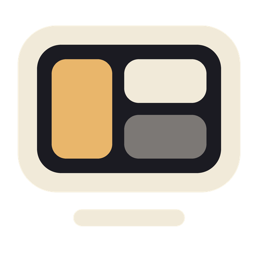

<p align="center"></p>

# Mondesk

[中文](README.md) ｜ **English**

Back at your desk every Monday, and the little screen beside you keeps an eye on everything else.

## Download

Get it from [Releases](../../releases). Unzip and double-click: no Python to install, no commands to type.

| System | File | Open |
|---|---|---|
| Windows 10/11 | `Mondesk-windows.zip` | `Mondesk.exe`. For a quick look first, double-click `Mondesk 示範模式.bat` (demo mode) |
| Linux | `Mondesk-linux.tar.gz` | `./Mondesk` (the panel opens in your browser). Demo: `./mondesk-demo.sh` |

- Demo mode runs on scripted data: no printer, account or key needed, and nothing is saved.
- Start with the computer, full screen: the "應用程式" (Application) section of the settings page. The window reopens on the same screen, at the same place and size as when it was closed.
- Opening `Mondesk.exe` again does not start a second copy; it brings the existing window to the front.
- Apple Music lyrics and YouTube / Bilibili video sync need the browser extension. It ships inside the package, and the "正在播放" (Now Playing) section of the settings page walks you through installing it (Chrome does not let programs install extensions, so it has to be loaded by hand once).
- On first launch Windows may show "Windows protected your PC": the program is not code-signed. Click "More info" → "Run anyway". Computers with **Smart App Control** turned on refuse every unsigned program; use the source version below (`Mondesk.bat`) there.
- On Linux, the system volume card and system-wide "now playing" need Windows; everything else works the same.

The interface is in Traditional Chinese.

## What it is

A dashboard for the small screen on your desk: a 3D printer, what's playing (with synced lyrics), Codex / Claude usage, and a Companion character that watches all of it and speaks up on its own.
Runs on Windows and Linux; everything is configured on a local web page.

| Card | Shows |
|---|---|
| 3D printer (Bambu Lab) | Progress, time left, temperatures, model preview, chamber camera, one-tap Bambu Studio |
| Now Playing | Cover, time left, playback controls. Tap the card: Apple Music shows full-screen synced lyrics; YouTube and Bilibili videos are played by the panel itself, muted and in sync (the original tab keeps playing and may be covered); only other sites fall back to capturing the tab |
| AI usage | Today's tokens, 5-hour / 7-day quota % |
| Companion | An AI buddy with a face: on print finished / failed, high quota, song changes or long work stretches it says a line or two and changes expression; tap the face for a status report. Characters are swappable and character packs can be imported (see [docs/COMPANION.md](docs/COMPANION.md), [docs/CHARACTER-FORMAT.md](docs/CHARACTER-FORMAT.md)) |
| System | Volume (with mute), brightness of DDC/CI monitors, and dimming of the panel screen itself |
| Weather | Temperature, conditions, today's high/low and chance of rain, the next few hours; warns before rain (data from Open-Meteo, no account) |
| Clock | Five styles (digital, analog, flip, ring, words), readable at any size. Tap it for full screen, with timer and stopwatch pages: set the countdown with the scroll wheel; when time is up the screen edges glow. With a clock card on the panel, the small time in the header is hidden |

The layout is yours: touch the screen, tap the pencil at the top left, then drag cards and resize them from the bottom-right corner (6×8 grid). ✕ puts a card away in the widget drawer. The small gear on each card opens that card's settings; the gear at the top left holds only screen and colour settings.

**Modes**: touch the screen and use the mode button at the top left to switch the whole layout between Custom / Focus / Print / Rest; printing can switch to Print automatically. With a mode on, the pencil edits that mode's own layout. Layouts can be exported as "layout packs" (layout, modes and colours only, never accounts or keys); the settings page includes Focus, Media and Print templates.

**Events**: print finished / failed, high quota, rain soon, timer done and long work stretches are each recorded once. The Companion says them when it is on screen; otherwise a notice pops up at the bottom of the panel. The settings page's event log shows them all.

## Try it first (no account or device needed)

```bash
run-demo.bat        # Windows; on Linux ./run-demo.sh
```

Demo mode scripts the printer, music (with lyrics), AI quota and weather in a loop of about four minutes: a print finishes, the second one fails, quota passes 80%, songs change, rain is coming. The character, event log, modes and layout editor are all real. Your settings are neither read nor written.

## Check that this copy works

```bash
check.bat           # Windows; on Linux ./check.sh
```

Checks packages, runs the Python and JavaScript tests (JavaScript is skipped without Node.js), then starts a demo server once to check the pages and API. No account, printer or key needed.

## Install and run from source

Needs Python 3.10 or later.

```bash
# Windows
run.bat

# Linux
./run.sh
```

The first start creates a virtual environment, installs packages and creates the user settings from `config.example.json`; no real user settings are kept in the program folder.

As its own window (not a browser tab): `Mondesk.bat` on Windows, `./run-desktop.sh` on Linux. Settings live in `%LOCALAPPDATA%/DeskMon/config.json` on Windows and `$XDG_CONFIG_HOME/DeskMon/config.json` on Linux (`~/.config/DeskMon/config.json` when unset). Server and desktop share this path; use `--config` to point at another file during development.

The downloadable application is built with `python tools/build_app.py` (needs `pip install -r requirements-desktop.txt -r requirements-build.txt`); it builds only for the system it runs on. Pushing a tag starting with `v` makes [.github/workflows/release.yml](.github/workflows/release.yml) build both the Windows and Linux versions on GitHub and attach them to Releases. Icons are drawn by `python tools/make_icons.py`. The application creates `browser-extension/` next to the user settings, with the pairing address set to the real port; Chrome loads "Mondesk — Now Playing" from that folder.

- Panel: <http://127.0.0.1:9361>
- Settings: <http://127.0.0.1:9361/settings.html> (or the gear at the top left of the panel)

Linux additionally needs `playerctl` (now playing) and `xrandr` (resolution list).

## Settings and accounts

**Every credential is entered by you on the settings page, and the only source of settings is the local user config.** The browser connector's pairing data is generated from it into the same user folder and is never part of a release package.
When the settings page reads the settings, secret fields such as access codes show only `••••••`; the real values never leave the server.

| Feature | Needs | Default |
|---|---|---|
| Bambu printer | Printer IP, serial number, LAN access code (shown on the printer's screen) | Off |
| Official Claude % | Having signed in with the `claude` command (Claude Code) on this computer | Off, turn it on yourself |
| Companion (Claude) | An Anthropic API key (on the settings page, or the `ANTHROPIC_API_KEY` environment variable); or a local Ollama model, or free rule-based lines | Off |
| Apple Music synced lyrics | Pair with `python -m modules.apple_bridge` and load `apple-music-extension` in Chrome (lyrics come from Apple Music only) | Off |

## External services it contacts

Mondesk binds to `127.0.0.1` only. These are the places it connects to; anything not on by default must be turned on in settings:

| Service | Purpose | Data sent | Default |
|---|---|---|---|
| Your printer (LAN) | Status, preview, camera | None (receive only) | On once configured |
| iTunes Search API | Cover art, song length | Song title, artist | On |
| Anthropic | Official Claude usage % | Your Claude Code sign-in token | Off |
| Anthropic Messages API | Companion lines (with the Claude brain) | Event name, time, continuous work time, and print status, song title and AI usage queried by the model | Off |
| Ollama (local) | Companion local model (with the Ollama brain) | Same as above, sent only to your own computer | Off |
| Open-Meteo; the Norwegian Meteorological Institute (api.met.no) when unreachable | Forecast, place search on the settings page | Latitude/longitude of the place you chose; the place name you type when searching | Off (on once a weather card is placed and a place chosen) |

Note: official Claude usage, the Apple Music extension and the Bambu Studio camera tool are **not official public interfaces**. They may break when the other side changes, and you should check each service's terms yourself before using them.

## Security

- The server only accepts requests from this computer (`127.0.0.1` / `localhost`) and from Mondesk's own pages;
  every write API requires an `X-DeskMon` header, so other websites cannot change settings or trigger actions for you.
- "Open Bambu Studio" only starts a program named `bambu-studio`.
- The printer is **watch-only** by default. Recent Bambu firmware in cloud mode rejects control commands from unofficial software (error 84033543); use Bambu Studio / Handy for control.

## Chamber camera

Bambu Studio's camera tool (`bambu_source`) is preferred: it works in cloud mode and needs no LAN Only Liveview.
When it is not running, the printer's LAN stream is used instead (LAN Only Liveview must be enabled on the printer).

## Development

```bash
python tools/check.py                        # packages, all tests, demo server (same as check.bat)
python -m unittest discover -s tests -t .    # Python tests only
node --test tests/*.cjs                      # JavaScript tests only (Node.js 18+)
python tools/companion_eval.py               # Companion fixed event set and a day's line count
```

- New data source: follow the contract in [docs/MODULES.md](docs/MODULES.md); `modules/weather.py` is the example.
- The three video display paths and when they are released: [docs/VIDEO.md](docs/VIDEO.md).
- What each card shows at each size and its minimum size: [docs/LAYOUT.md](docs/LAYOUT.md).
- Themes (background, shape, accent colour, per-card colours, modes and night, following the cover): [docs/THEME.md](docs/THEME.md).
- On-device acceptance steps: [docs/ACCEPTANCE.md](docs/ACCEPTANCE.md); status and to-do: [docs/ROADMAP.md](docs/ROADMAP.md).

The documents under `docs/` are in Chinese.

## License

[MIT](LICENSE)
