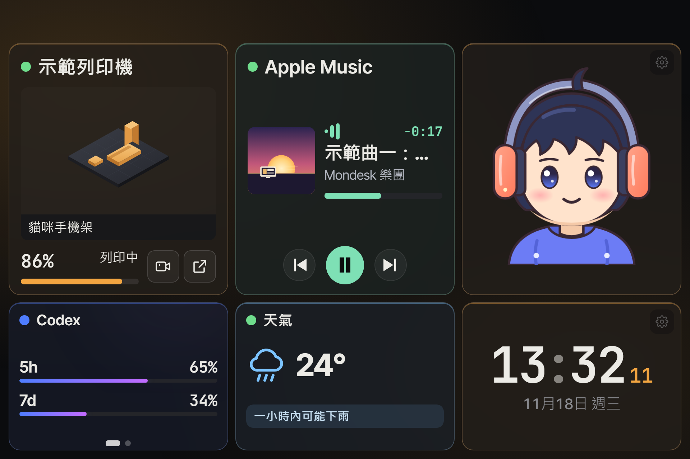

<p align="center"></p>

# Mondesk

**中文** ｜ [English](README.en.md)

每個禮拜一坐回桌前，旁邊那塊小螢幕幫你盯著其他事。

<p align="center"></p>

## 有哪些卡片

- **3D 列印機**（Bambu Lab）：進度、剩餘時間、模型預覽、機艙直播
- **正在播放**：Apple Music 同步歌詞；YouTube、B 站影片在小螢幕上同步播放
- **AI 用量**：Codex／Claude 的 5 小時、7 天額度
- **Companion**：會看上面這些資料、有表情、主動提醒你的 AI 角色
- **天氣**、**時鐘**（含計時器、碼錶）、**系統**（音量、螢幕亮度）

卡片的位置和大小都能直接拖曳調整，也能切換「專注／列印／休息」等情境模式。

## 下載

到 [Releases](../../releases) 下載，解壓縮後點兩下就能用，不用安裝 Python。

| 系統 | 檔案 | 開啟 |
|---|---|---|
| Windows 10／11 | `Mondesk-windows.zip` | `Mondesk.exe` |
| Linux | `Mondesk-linux.tar.gz` | `./Mondesk`（面板開在瀏覽器裡） |

- 開機自動啟動、全螢幕：設定頁的「應用程式」。
- Apple Music 歌詞與影片同步需要瀏覽器擴充功能，設定頁「正在播放」有安裝說明。
- Windows 版裡附的是 Python 官方的免安裝版，`Mondesk.exe` 保留 Python 官方的數位簽章，開著「智慧型應用程式控制」的電腦也能執行。

## 從原始碼安裝

需要 Python 3.10 以上。

```bash
Mondesk.bat         # Windows
./mondesk.sh        # Linux
```

第一次啟動會自動建立環境、安裝套件。設定存在 `%LOCALAPPDATA%\DeskMon`（Linux：`~/.config/DeskMon`），不在程式資料夾裡。面板也可以用瀏覽器開：<http://127.0.0.1:9361>。

## 設定與帳號

**所有憑證由你在設定頁輸入，設定來源只有本機 user config**。瀏覽器連接器的必要配對資料由該設定產生在同一個使用者目錄，不會放進發佈包。
設定頁讀取設定時，存取碼等機密欄位只會顯示 `••••••`：原值只存在你電腦上的設定檔裡，由本機的 Mondesk 程式（`127.0.0.1`）使用，連設定頁本身都拿不到，更不會上傳到任何地方。

| 功能 | 需要什麼 | 預設 |
|---|---|---|
| Bambu 列印機 | 印表機 IP、序號、LAN 存取碼（印表機螢幕上可查） | 關閉 |
| Claude 官方 % | 在這台電腦用 `claude` 指令登入過 Claude Code | 關閉，需自行開啟 |
| Companion（Claude） | Anthropic API 金鑰（設定頁輸入，或環境變數 `ANTHROPIC_API_KEY`）；也可改用本機 Ollama 或不花錢的規則式台詞 | 關閉 |
| Apple Music 同步歌詞 | 執行 `python -m modules.apple_bridge` 配對，並在 Chrome 載入 `apple-music-extension`（歌詞只來自 Apple Music） | 關閉 |

## 會連到哪些外部服務

Mondesk 只綁定 `127.0.0.1`。以下是它會主動連線的地方，非預設的都要在設定頁自行開啟：

| 服務 | 用途 | 送出的資料 | 預設 |
|---|---|---|---|
| 你的印表機（區網） | 讀取狀態、預覽圖、直播 | 無（只接收） | 設定後啟用 |
| iTunes Search API | 封面、歌曲長度 | 歌名、歌手 | 開啟 |
| Anthropic | Claude 官方用量 % | 你的 Claude Code 登入權杖 | 關閉 |
| Anthropic Messages API | Companion 產生台詞（選 Claude 大腦時） | 事件名稱、時間、連續工作時間，以及模型查詢的列印狀態、歌名、AI 用量 | 關閉 |
| Ollama（本機） | Companion 本機模型（選 Ollama 大腦時） | 同上，只送到你的電腦 | 關閉 |
| Open-Meteo；連不上時改用挪威氣象局（api.met.no） | 天氣預報、設定頁的地名搜尋 | 你選的地點的經緯度；搜尋時送出你輸入的地名 | 關閉（放上天氣卡並選地點後啟用） |

注意：Claude 官方用量、Apple Music 擴充功能、Bambu Studio 直播工具都**不是官方公開的介面**，對方改版時可能失效，使用前請自行確認是否符合各服務條款。

## 安全性

- 伺服器只接受來自本機（`127.0.0.1`／`localhost`）且來自 Mondesk 自己頁面的請求；
  所有寫入類 API 需要 `X-DeskMon` 標頭，其他網站無法替你送出設定或操作。
- 「開啟 Bambu Studio」只會啟動名為 `bambu-studio` 的程式。
- 列印機預設**只監看**。Bambu 新版韌體在雲端模式會拒絕非官方軟體的控制指令（錯誤 84033543），請用 Bambu Studio／Handy 操作。

## 機艙直播

優先使用 Bambu Studio 的攝影機直播工具（`bambu_source`，雲端模式可用，不需要 LAN Only Liveview）；
沒有在執行時，改用印表機的 LAN 直播（需在印表機開啟 LAN Only Liveview）。

## 開發

```bash
python tools/check.py                        # 套件、全部測試、示範伺服器
python -m unittest discover -s tests -t .    # 只跑 Python 測試
node --test tests/*.cjs                      # 只跑 JavaScript 測試（需要 Node.js 18 以上）
python tools/companion_eval.py               # Companion 固定事件集與一天的說話次數
```

- 新增資料來源：照 [docs/MODULES.md](docs/MODULES.md) 的契約，`modules/weather.py` 是範例。
- 影片顯示的三條路徑與釋放時機：[docs/VIDEO.md](docs/VIDEO.md)。
- 卡片在不同大小顯示什麼、最小幾格：[docs/LAYOUT.md](docs/LAYOUT.md)。
- 主題（背景、外型、主題色、卡片各自的顏色、情境與夜間、跟著封面）：[docs/THEME.md](docs/THEME.md)。
- 實機驗收步驟：[docs/ACCEPTANCE.md](docs/ACCEPTANCE.md)；現況與待辦：[docs/ROADMAP.md](docs/ROADMAP.md)。

## 授權

[MIT](LICENSE)
